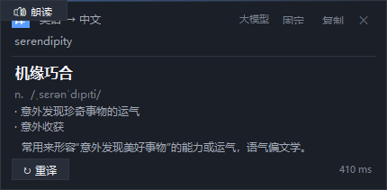
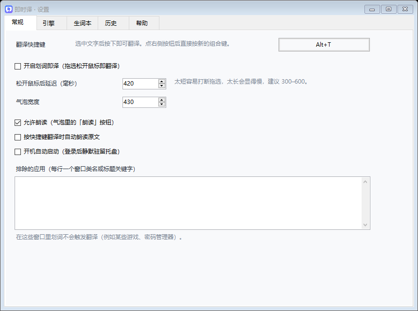

# 即时译 · InstaTranslate

在**任何软件**里选中中文或英文，按一下快捷键，译文就贴在文字旁边。

Windows 桌面常驻小工具，单文件 110 KB，无浏览器内核、无外部依赖、不收集任何数据。



---

## 特点

- **随处可用**：浏览器、PDF、Word / Excel / PPT、微信 / 钉钉、记事本、IDE——只要能选字就能翻
- **两条取词路径**：优先用 Windows UI Automation 直接读选区（不发按键、无副作用），不支持时退回「模拟 Ctrl+C + 剪贴板」
- **中英自动判向**：中文→英文、英文→中文，日/韩/俄→中文，也可锁定目标语言
- **三种引擎**：DeepSeek 兼容接口（质量最好）/ 必应（免 Key，开箱可用）/ 自动降级
- **单词模式**：给音标、词性、多义项和用法说明
- **划词即译**：拖选松开鼠标就翻译，不用按键
- **生词本 + 历史**：可搜索、可导出 CSV（带 BOM，Excel 不乱码，可导 Anki）
- **朗读**：调用 Windows 内置语音
- **常驻托盘**：关窗口不退出，开机自启用计划任务实现（不弹 UAC）



---

## 安装

1. 下载 `InstaTranslate-x.y.z-setup.exe`，双击安装（**不需要管理员权限**）
2. 若弹「Windows 已保护你的电脑」→ 点「更多信息」→「仍要运行」（程序未做代码签名）
3. 右下角托盘出现「译」图标（可能在 `^` 展开区里）
4. 任意软件里选中文字 → 按 `Alt + C`

卸载：设置 → 应用 → 即时译 → 卸载。**不会删除**你的历史与生词本。

### 绿色版

不想安装：把 `InstaTranslate.exe` 和 `assets\` 放在同一个文件夹里直接运行即可。

---

## 使用

### 快捷键

选中文字 → `Alt + C`（可在设置里改，支持 `Ctrl`/`Alt`/`Shift` + 字母，或 `F1`~`F12` 单键）。

### 划词即译

设置 → 常规 → 勾选「开启划词即译」。拖选文字松开鼠标就翻译。
只在真的拖动了（位移 ≥ 8px、按住 ≥ 80ms）才触发，单击和滚动不会误触。

### 气泡上的按钮

| 按钮 | 作用 |
|---|---|
| 固定 | 气泡常驻，点别处不消失 |
| 复制 | 复制译文 |
| ✕ / `Esc` | 关闭（气泡 6 秒后也会自动收起，鼠标悬停顺延） |
| ♡ 生词本 | 收藏 / 取消 |
| ↻ 重译 | 换引擎重翻（大模型 ↔ 必应） |
| 🔊 朗读 | 用系统语音读译文 |

### 托盘菜单

翻译剪贴板内容 · 输入翻译… · 划词即译开关 · 取词诊断 · 生词本/历史 · 设置 · 开机自启动 · 退出

---

## 翻译引擎与 API Key

| 引擎 | 说明 |
|---|---|
| **自动**（默认） | 填了 Key 用大模型，没填用必应 |
| **大模型** | 任意 OpenAI 兼容的 `/chat/completions` 接口，默认 DeepSeek |
| **必应** | 微软网页翻译，免 Key |

程序**不内置任何 Key**。没有 Key 时自动使用必应，完全可用。
想用大模型：设置 → 引擎 → 填自己的 API 地址与 Key（只保存在本机 `%APPDATA%\InstaTranslate\settings.json`）。

---

## 数据与隐私

- 设置、历史、生词本只存在本机 `%APPDATA%\InstaTranslate\`
- 日志在 `%TEMP%\InstaTranslate\app.log`（上限 512 KB，自动轮转）
- 程序不收集任何统计、不上传文件
- **翻译时选中的文字会发送到所选引擎**（必应 / 你自己的大模型接口），这一点请在分发时告知使用者

---

## 常见问题

**提示"没有取到选中的文字"？**
气泡里会写出具体原因。常见三种：

| 提示 | 原因 | 处理 |
|---|---|---|
| 权限过低 | 程序被放进了带「低完整性」标记的目录，或目标程序是管理员权限 | 换到普通目录运行；或托盘 → 以管理员身份重启 |
| 目标程序以管理员权限运行 | 普通权限读不到其选区 | 托盘 → 以管理员身份重启 |
| 都没有 | 选中的是图片、或该控件不暴露选区 | 改用「翻译剪贴板内容」 |

**快捷键没反应？**
设置里会显示「全局快捷键已注册」或「注册失败」。失败说明被别的软件占用了（QQ、输入法、截图工具都常见），换一个组合键。

**会改我的剪贴板吗？**
用剪贴板取词时会先备份、读完立刻还原。唯一例外是云剪贴板/剪贴板历史工具会记录这一瞬间。

**支持哪些系统？**
Windows 10 1809+ / Windows 11，需要 .NET Framework 4.8（Win10 1903+ 与 Win11 自带）。

---

## 开发

要求：Windows + .NET Framework 4.8（用系统自带的 `csc.exe` 编译，无需安装 SDK）+ Node.js（仅用于构建脚本）。

```bat
node scripts\make-icon.js         :: 生成图标（纯代码绘制）
node scripts\build-native.js      :: 编译程序
node scripts\build-installer.js   :: 打包安装程序
```

自测：

```bat
InstaTranslate.exe --selftest     :: 权限 / 取词链路 / 翻译引擎 / 语音 / 存储
InstaTranslate.exe --live-test    :: 自动开记事本 → 选中 → 走真实取词 → 报结论
InstaTranslate.exe --ui-snapshot  :: 把界面渲染成 PNG（无桌面环境也能检查排版）
InstaTranslate.exe --diag         :: 3 秒后对当前选区跑一次取词诊断
```

### 结构

```
src/native/     主程序（C# 5 / WinForms）
  Program.cs        入口、单实例握手、自检、快照
  TrayContext.cs    托盘、全局热键、鼠标轮询、翻译编排
  PopupForm.cs      翻译气泡
  SettingsForm.cs   设置窗口
  UiaReader.cs      UI Automation 取选区
  Native.cs         Win32 互操作、剪贴板取词、权限级别、语音
  Engines.cs        必应 / 大模型 / 历史与生词本
  Core.cs           配置、语言判定、HTTP、JSON
src/installer/  安装/卸载程序（把主程序作为资源嵌入，单文件分发）
scripts/        构建脚本（图标、编译、打包）
docs/           规划、分发说明、界面截图
```

### 已知限制

- 全屏游戏、DRM 保护窗口、部分自绘界面取不到词（这些窗口本身禁止读取选区）
- 目标程序以管理员权限运行时，需以管理员身份运行本程序
- 仅 Windows

---

## 致谢与参考

取词思路参考了 pot-desktop、Bob、欧路词典等同类工具：**全局热键 + 读取选区**。
本项目的取舍是优先用 UI Automation（无副作用、不受注入限制），失败才退回模拟 `Ctrl+C`。

---

## License

[MIT](LICENSE) © 2026 郑铮培
